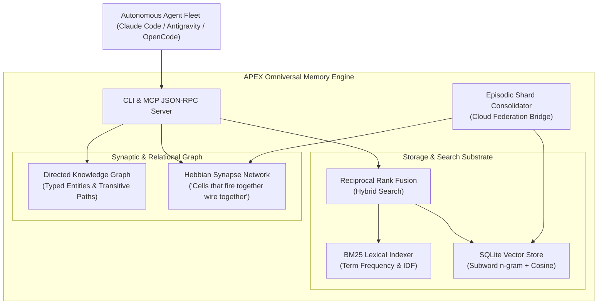

# APEX Memory SDK

[](https://github.com/GlacierEQ/apex-memory-sdk/actions/workflows/ci.yml)
[](https://pypi.org/project/apex-memory-sdk/)
[](https://pypi.org/project/apex-memory-sdk/)
[](https://www.python.org/)
[](LICENSE)
[](https://docs.python.org/3/library/sqlite3.html)
[](https://modelcontextprotocol.io/)

**APEX Memory SDK** is a sovereign omniversal semantic memory engine and knowledge graph mesh designed for autonomous agent fleets. It combines zero-dependency local SQLite vector storage, subword n-gram vector embeddings, BM25 hybrid lexical ranking, dynamic Hebbian synaptic reinforcement, persistent directed knowledge graphs, and cross-cloud episodic memory consolidation.



---

## Key Capabilities

1. **Zero-Dependency Vector Storage**: Pure Python and native SQLite3 vector storage without heavyweight external C-extensions, Torch, or external vector databases.
2. **Subword N-Gram Embeddings**: Robust character n-gram hash vectorization providing out-of-vocabulary resilience, typo tolerance, and deterministic offline representation.
3. **BM25 & Reciprocal Rank Fusion (RRF)**: Combines dense vector cosine similarity with exact lexical term frequency scoring for industry-standard hybrid recall precision.
4. **Hebbian Synaptic Network**: Implements biological Hebbian learning ("cells that fire together wire together") with configurable temporal exponential decay and synaptic pruning.
5. **Directed Knowledge Graph**: Typed entities and labeled relations supporting cyclic detection, transitive path traversals, and multi-hop entity reasoning.
6. **Cross-Cloud Shard Consolidation**: Serializes, cryptographically hashes, and exports consolidated memory shards to multi-cloud storage via `apex_cloud`.
7. **Model Context Protocol (MCP) Server**: Provides persistent semantic recall directly to AI agents over standard stdio JSON-RPC 2.0.

---

## Installation

```bash
cd /root/workspace/projects/apex-memory-sdk
pip install -e ".[test]"
```

Verify installation:
```bash
apex-memory info
```

---

## Python API Usage

### 1. Vector Store & Hybrid Search

```python
from apex_memory.substrate.vector_store import VectorStore

store = VectorStore(":memory:")

# Store memories with semantic content and tags
store.put(
    item_id="DOC-001",
    content="Casey Barton is defending against false CVB citation at Pearl Harbor NEX",
    tags=["cvb", "litigation", "defense"],
)
store.put(
    item_id="DOC-002",
    content="Surveillance logs show arrival at 14:00 and departure at 14:40",
    tags=["alibi", "timeline"],
)

# Hybrid recall combining subword vector similarity and BM25 ranking
results = store.hybrid_search("surveillance arrival timeline", top_k=2)
for item, score in results:
    print(f"[{item.item_id}] Score: {score:.3f} -> {item.content}")
```

### 2. Hebbian Synapse Reinforcement

```python
from apex_memory.synapse.hebbian import HebbianNetwork

network = HebbianNetwork()

# Co-activation strengthens synaptic connection weight
edge1 = network.fire("CVB_CITATION", "ALIBI_TIMELINE", delta=0.4)
edge2 = network.fire("CVB_CITATION", "ALIBI_TIMELINE", delta=0.3)
print(f"Synaptic weight: {edge2.weight:.2f}")  # 0.70

# Simulate temporal decay over inactive synapses
network.decay_all(decay_factor=0.9)
print(f"Decayed weight: {network.get_edge('CVB_CITATION', 'ALIBI_TIMELINE').weight:.2f}")

# Associative activation recall
associated = network.get_associated("CVB_CITATION", threshold=0.5)
print("Strongly associated nodes:", associated)
```

### 3. Directed Knowledge Graph Traversals

```python
from apex_memory.graph.knowledge_graph import KnowledgeGraph
from apex_memory.graph.traversal import GraphTraversal

kg = KnowledgeGraph()

kg.add_node("CASE_CVB", node_type="Case", properties={"status": "ACTIVE"})
kg.add_node("ALIBI_RECORD", node_type="Evidence", properties={"verified": True})
kg.add_node("CUSTODIAN_FPD", node_type="Person", properties={"agency": "FPD"})

kg.add_edge("CASE_CVB", "ALIBI_RECORD", relation="SUPPORTED_BY")
kg.add_edge("ALIBI_RECORD", "CUSTODIAN_FPD", relation="SUBMITTED_TO")

traversal = GraphTraversal(kg)
paths = traversal.find_paths("CASE_CVB", "CUSTODIAN_FPD", max_depth=3)
for path in paths:
    print("Transitive Path:", " -> ".join(path))
```

### 4. Cross-Cloud Episodic Memory Consolidation

```python
from apex_memory.federation.consolidator import MemoryConsolidator

consolidator = MemoryConsolidator(store, network)
shard = consolidator.consolidate("SHARD-2026-11-08")

print("Consolidated Shard ID:", shard["shard_id"])
print("Items:", len(shard["items"]))
print("Synapses:", len(shard["synapses"]))
print("Cryptographic Digest:", shard["sha256"])
```

---

## Cross-References

APEX Memory SDK is part of the GlacierEQ mainframe mesh:

| Repo | Role | Relationship |
|------|------|--------------|
| [apex-agent-sdk](https://github.com/GlacierEQ/apex-agent-sdk) | Agent lifecycle | Consumes memory via MCP |
| [apex-cloud-sdk](https://github.com/GlacierEQ/apex-cloud-sdk) | Cloud storage | Shard consolidation target |
| [agentic-foundation](https://github.com/GlacierEQ/agentic-foundation) | Swarm lib | Memory substrate |
| [computer-user](https://github.com/GlacierEQ/computer-user) | Desktop automation | Memory host |

## CLI Reference

`apex-memory` gives instant control over agent persistent memory:

```bash
# Check memory status and substrate health
apex-memory info

# Store memory item with metadata tags
apex-memory remember "FACT-01" "Federal citation requires mens rea under Morissette" --tags legal doctrine

# Recall memories using hybrid vector + BM25 search
apex-memory recall "mens rea requirement" --top-k 3

# Reinforce synaptic association between two conceptual nodes
apex-memory associate "Doctrine_Morissette" "Strict_Liability_Refusal" --delta 0.5

# Consolidate memory shard to file
apex-memory consolidate "SHARD-001" -o "/tmp/shard_001.json"

# Launch MCP stdio server
apex-memory mcp
```

---

## Model Context Protocol (MCP) Integration

To provide persistent memory to AI agents (Claude Code, Antigravity, OpenCode), add to your MCP settings:

```json
{
  "mcpServers": {
    "apex-memory": {
      "command": "apex-memory",
      "args": ["mcp"],
      "env": {
        "APEX_MEMORY_DB": "/root/.apex/memory.sqlite3"
      }
    }
  }
}
```

Exposed MCP Tools:
- `memory_info`: Overview of memory size, vector count, and synaptic density.
- `memory_remember`: Store arbitrary text payload with tags and metadata.
- `memory_recall`: Retrieve top-k semantically relevant memories via hybrid search.
- `memory_associate`: Dynamically reinforce or decay synaptic connections.
- `memory_graph_add`: Register knowledge graph entities and relationships.
- `memory_graph_traverse`: Query multi-hop relationships and paths across entities.
- `memory_consolidate`: Package episodic memories into portable, signed shards.

---

## Testing & Quality Gate

```bash
pytest -v
```

All 15 test suites execute offline in <0.3s with zero external dependencies.
