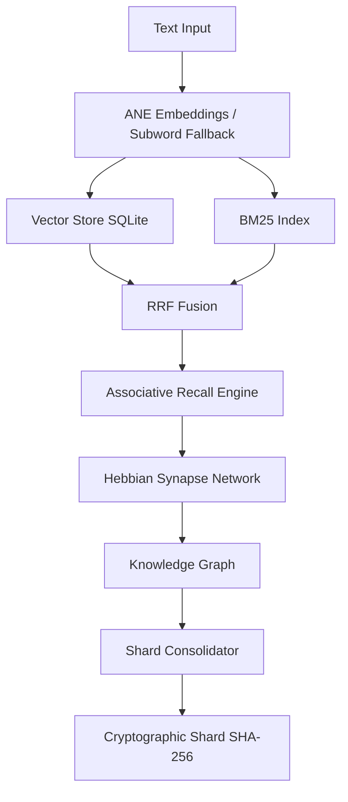

# APEX Memory SDK — Architecture

## System Architecture

## Component Overview

### 1. Substrate Layer
- **VectorStore**: SQLite-backed, stores embeddings + BM25 tokens
- **SubwordEmbeddingEngine**: Hash-based n-gram fallback
- **ANEEmbeddingEngine**: CoreML on Apple Neural Engine (384-dim, 0.71ms/embed)
- **BM25**: Keyword ranking with IDF scoring
- **Fusion**: Reciprocal Rank Fusion (RRF) combining vector + BM25

### 2. Synapse Layer
- **HebbianNetwork**: Biological learning — fire (reinforce), decay, prune
- **AssociativeRecallEngine**: Hybrid recall with synaptic expansion

### 3. Graph Layer
- **KnowledgeGraph**: Directed entities + relations
- **Traversal**: BFS transitive path finding

### 4. Federation Layer
- **MemoryConsolidator**: Export shard with SHA-256 cryptographic digest
- **Shard**: Portable memory snapshot (memories + synapses + graph)

### 5. Interface Layer
- **CLI**: remember/recall/associate/consolidate/mcp/serve/stop/status/query/seed/info
- **MCP Server**: JSON-RPC 2.0 stdio + HTTP mode
- **SKILL.md**: Agent skill manifest

## Data Flow

1. **Remember**: Text → Embedding → Vector Store + BM25 + Synapse + Graph
2. **Recall**: Query → Vector Search + BM25 + RRF Fusion → Synaptic Expansion → Results
3. **Associate**: Fire synapse → Reinforce weight → Decay/prune over time
4. **Consolidate**: Snapshot all state → SHA-256 hash → Portable shard
5. **Seed**: Markdown files → Chunk by headers → Store each chunk

## Storage

- **Database**: SQLite at `~/.apex/memory.sqlite3` (configurable via `APEX_MEMORY_DB`)
- **ANE Model Cache**: Module-level dict keyed by (dimensions, max_seq_len)
- **Server State**: `server.json` alongside database

## Performance

| Metric | Value |
|--------|-------|
| ANE embedding latency | 0.71ms |
| Semantic similarity (related) | 0.997 |
| Test suite | 20 tests, <5s |
| Init time (cached) | 0ms |
| Init time (cold) | ~4s (ANE model build) |
